Software developer building web and mobile products, from database to UI. Information Systems student at UPN Veteran Jakarta.

## Currently

- Building **KostaHub**, a farm management web app (Next.js, Prisma).
- Rebuilding **reddog.co.id** with Next.js and Supabase.
- Studying Information Systems at UPN Veteran Jakarta.

## Tech Stack

**Languages** 

**Frontend** 

**Backend** 

**Mobile** 

**Databases** 

**Cloud & DevOps** 

**Tools** 

**Testing** 

## Featured Projects

  
  
   
  
  

## GitHub Stats

  
  
   
  

## Contact

