  

  

<h3></h3>

  

<h3></h3>

<table>
  <tr>
    <td width="50%" align="center">
      <b>STAGE 1-1</b> 
      <a href="https://github.com/achmf/KostaHub"><b>KostaHub</b></a> 
      Goat farm management web app for Koni Farm 
      
    </td>
    <td width="50%" align="center">
      <b>STAGE 1-2</b> 
      <a href="https://github.com/achmf/femlife"><b>femlife</b></a> 
      Women's health and wellness Android app 
      
    </td>
  </tr>
  <tr>
    <td width="50%" align="center">
      <b>STAGE 1-3</b> 
      <a href="https://github.com/achmf/flavorize"><b>flavorize</b></a> 
      Android app to share, find and learn recipes 
      
    </td>
    <td width="50%" align="center">
      <b>STAGE 1-4</b> 
      <a href="https://github.com/achmf/reddog-next"><b>reddog-next</b></a> 
      Developing the existing reddog.co.id website 
      
    </td>
  </tr>
</table>

<h3></h3>

  
  
   
  

<h3></h3>

  <picture>
    <source media="(prefers-color-scheme: dark)" srcset="https://achmf-pacman-api.vercel.app/api/pacman?theme=dark">
    
  </picture>

<h3></h3>

  
  
  
  

  

