<div align="center">
  
</div>

<div align="center">
  
</div>

### ▶ PLAYER 1

```text
╔══════════════════════════════════════╗
║ NAME  : ACHMF                        ║
║ CLASS : MOBILE & WEB DEVELOPER       ║
║ GUILD : UPN VETERAN JAKARTA          ║
║ QUEST : SHIP APPS PEOPLE LOVE        ║
║ ITEM  : ☕ + 🐱                      ║
╚══════════════════════════════════════╝
```

### ▶ INVENTORY

<div align="center">
  
</div>

### ▶ SELECT STAGE

<table>
  <tr>
    <td width="50%" align="center">
      <b>STAGE 1-1</b><br>
      <a href="https://github.com/achmf/KostaHub"><b>KostaHub</b></a><br>
      Goat farm management web app for Koni Farm<br>
      
    </td>
    <td width="50%" align="center">
      <b>STAGE 1-2</b><br>
      <a href="https://github.com/achmf/femlife"><b>femlife</b></a><br>
      Women's health and wellness Android app<br>
      
    </td>
  </tr>
  <tr>
    <td width="50%" align="center">
      <b>STAGE 1-3</b><br>
      <a href="https://github.com/achmf/flavorize"><b>flavorize</b></a><br>
      Android app to share, find and learn recipes<br>
      
    </td>
    <td width="50%" align="center">
      <b>STAGE 1-4</b><br>
      <a href="https://github.com/achmf/reddog-next"><b>reddog-next</b></a><br>
      Developing the existing reddog.co.id website<br>
      
    </td>
  </tr>
</table>

### ▶ PLAYER STATS

<div align="center">
  
  
  <br>
  
</div>

### ▶ HIGH SCORE

<div align="center">
  <picture>
    <source media="(prefers-color-scheme: dark)" srcset="https://raw.githubusercontent.com/achmf/achmf/output/pacman-contribution-graph-dark.svg">
    
  </picture>
</div>

### ▶ CONTINUE?

<div align="center">
  <a href="https://www.linkedin.com/in/achmf/"></a>
  <a href="mailto:farizi1412@gmail.com"></a>
  <a href="https://achmf.vercel.app/"></a>
  <a href="https://www.instagram.com/achmf_/"></a>
</div>

<div align="center">
  
</div>
